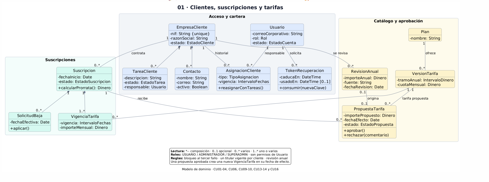
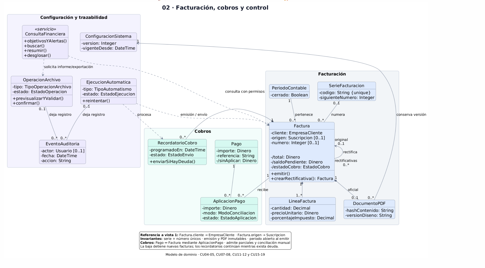

### PRIMER DIAGRAMA CLIENTES SUSCRIPCIONES TARIFAS

@startuml ClientesSuscripcionesTarifas

' Descomentar para mostrar todos los atributos y operaciones:
' !define DETALLE

!pragma layout smetana

skinparam backgroundColor #FFFFFF
skinparam shadowing false
skinparam roundcorner 12
skinparam defaultFontName SansSerif
skinparam defaultFontSize 18
skinparam titleFontSize 24
skinparam captionFontSize 14

skinparam classFontSize 20
skinparam classAttributeFontSize 18
skinparam classAttributeIconSize 0
skinparam classBorderColor #475569
skinparam classBackgroundColor #FFFFFF

skinparam ArrowFontSize 15
skinparam ArrowColor #64748B

skinparam packageStyle rectangle
skinparam packageFontStyle bold
skinparam packageFontSize 18
skinparam packageBorderColor #CBD5E1

skinparam nodesep 35
skinparam ranksep 45

hide circle
hide empty members
top to bottom direction

title <color:#0F172A>01 · Clientes, suscripciones y tarifas</color>
caption Modelo de dominio · CU01–04, CU06, CU09–10, CU13–14 y CU16

package "Acceso y cartera" as Cartera #F1F5F9 {

  class Usuario #DBEAFE {
    - correoCorporativo: String
    - rol: Rol
    - estado: EstadoCuenta

!ifdef DETALLE
    - hashClave: String
    - intentosFallidos: Integer
    + registrarFallo()
    + desactivar()
!endif
  }

  class TokenRecuperacion #DBEAFE {
    - caducaEn: DateTime
    - usadoEn: DateTime [0..1]

!ifdef DETALLE
    - hashToken: String
!endif

    + consumir(nuevaClave)
  }

  class EmpresaCliente #DBEAFE {
    - nif: String {unique}
    - razonSocial: String
    - estado: EstadoCliente

!ifdef DETALLE
    - direccion: String
    - sector: String
    + reactivar()
!endif
  }

  class Contacto #DBEAFE {
    - nombre: String
    - correo: String
    - activo: Boolean

!ifdef DETALLE
    - telefono: String
    + desactivar()
!endif
  }

  class AsignacionCliente #DBEAFE {
    - tipo: TipoAsignacion
    - vigencia: IntervaloFechas

    + reasignarConTareas()
  }

  class TareaCliente #DBEAFE {
    - descripcion: String
    - estado: EstadoTarea
    - responsable: Usuario

!ifdef DETALLE
    - venceEn: DateTime [0..1]
    + reasignar(a: Usuario)
!endif
  }

  Usuario "1" -- "0..*" TokenRecuperacion : solicita

  Usuario "1" -- "0..*" AsignacionCliente : responsable

  EmpresaCliente "1" -- "0..*" AsignacionCliente : historial

  EmpresaCliente "1" *-- "0..*" Contacto

  EmpresaCliente "1" *-- "0..*" TareaCliente
}

package "Suscripciones" as Subs #F0FDFA {

  class Suscripcion #CCFBF1 {
    - fechaInicio: Date
    - estado: EstadoSuscripcion

!ifdef DETALLE
    - condicionesPago: String
    + activar()
    + pausar()
!endif

    + calcularProrrata(): Dinero
  }

  class SolicitudBaja #CCFBF1 {
    - fechaEfectiva: Date

!ifdef DETALLE
    - solicitadaEn: DateTime
    - estado: EstadoBaja
!endif

    + aplicar()
  }

  class VigenciaTarifa #CCFBF1 {
    - vigencia: IntervaloFechas
    - importeMensual: Dinero

!ifdef DETALLE
    - origen: PropuestaTarifa [0..1]
!endif
  }

  Suscripcion "1" *-- "0..*" SolicitudBaja

  Suscripcion "1" *-- "1..*" VigenciaTarifa
}

package "Catálogo y aprobación" as Catalogo #FFFBEB {

  class Plan #FEF3C7 {
    - nombre: String

!ifdef DETALLE
    - descripcion: String
    - activo: Boolean
!endif
  }

  class VersionTarifa #FEF3C7 {
    - tramoAnual: IntervaloDinero
    - cuotaMensual: Dinero

!ifdef DETALLE
    - versionTabla: String
    - vigenciaCatalogo: IntervaloFechas
!endif
  }

  class RevisionAnual #FEF3C7 {
    - importeAnual: Dinero
    - fuente: String
    - fechaRevision: Date

!ifdef DETALLE
    - fechaDatos: Date
    + proponerTramo()
!endif
  }

  class PropuestaTarifa #FEF3C7 {
    - importePropuesto: Dinero
    - fechaEfecto: Date
    - estado: EstadoPropuesta

!ifdef DETALLE
    - tipo: TipoPropuesta
    - resueltaPor: Usuario [0..1]
    - comentario: String [0..1]
!endif

    + aprobar()
    + rechazar(comentario)
  }

  Plan "1" -- "0..*" VersionTarifa : ofrece

  RevisionAnual "0..1" -- "0..1" PropuestaTarifa : origina

  VersionTarifa "1" -- "0..*" PropuestaTarifa : tarifa propuesta
}

EmpresaCliente "1" -- "0..*" Suscripcion : contrata

EmpresaCliente "1" -- "0..*" RevisionAnual : se revisa

Suscripcion "1" -- "0..*" PropuestaTarifa : recibe

VersionTarifa "1" -- "0..*" VigenciaTarifa

legend bottom
  <b>Lectura:</b> *-- composición · 0..1 opcional · 0..* varios · 1..* uno o varios
  <b>Roles:</b> USUARIO / ADMINISTRADOR / SUPERADMIN · son permisos de Usuario
  <b>Reglas:</b> bloqueo al tercer fallo · un titular vigente por cliente · revisión anual
  Una propuesta aprobada crea una nueva VigenciaTarifa en su fecha de efecto.
endlegend

@enduml

### SEGUNDO DIAGRAMA FACTURACIÓN COBROS Y CONTROL 

@startuml FacturacionCobrosControl

' Descomentar para mostrar todos los atributos y operaciones:
' !define DETALLE

!pragma layout smetana

skinparam backgroundColor #FFFFFF
skinparam shadowing false
skinparam roundcorner 12
skinparam defaultFontName SansSerif
skinparam defaultFontSize 18
skinparam titleFontSize 24
skinparam captionFontSize 14

skinparam classFontSize 20
skinparam classAttributeFontSize 18
skinparam classAttributeIconSize 0
skinparam classBorderColor #475569
skinparam classBackgroundColor #FFFFFF

skinparam ArrowFontSize 15
skinparam ArrowColor #64748B

skinparam packageStyle rectangle
skinparam packageFontStyle bold
skinparam packageFontSize 18
skinparam packageBorderColor #CBD5E1

skinparam nodesep 35
skinparam ranksep 45

hide circle
hide empty members
top to bottom direction

title <color:#0F172A>02 · Facturación, cobros y control</color>
caption Modelo de dominio · CU04–05, CU07–08, CU11–12 y CU15–19

package "Facturación" #F1F5F9 {

  class Factura #DBEAFE {
    - cliente: EmpresaCliente
    - origen: Suscripcion [0..1]
    - numero: Integer [0..1]

!ifdef DETALLE
    - estado: EstadoFactura
    - tipo: TipoFactura
    - fechas: FechasFactura
    - datosFiscales: InstantaneaFiscal
!endif

    - /total: Dinero
    - /saldoPendiente: Dinero
    - /estadoCobro: EstadoCobro

    + emitir()
    + crearRectificativa(): Factura
  }

  class LineaFactura #DBEAFE {

!ifdef DETALLE
    - concepto: String
!endif

    - cantidad: Decimal
    - precioUnitario: Dinero
    - porcentajeImpuesto: Decimal

!ifdef DETALLE
    - /subtotal: Dinero
!endif
  }

  class DocumentoPDF #DBEAFE {
    - hashContenido: String
    - versionDiseno: String

!ifdef DETALLE
    - ubicacion: String
    - generadoEn: DateTime
!endif
  }

  class SerieFacturacion #DBEAFE {
    - codigo: String {unique}
    - siguienteNumero: Integer

!ifdef DETALLE
    + reservarNumero(): Integer
!endif
  }

  class PeriodoContable #DBEAFE {
    - cerrado: Boolean

!ifdef DETALLE
    - intervalo: IntervaloFechas
    + cerrar()
!endif
  }

  Factura "1" *-- "1..*" LineaFactura

  Factura "1" *-- "0..1" DocumentoPDF : oficial

  SerieFacturacion "0..1" -- "0..*" Factura : numera

  PeriodoContable "1" -- "0..*" Factura : pertenece

  Factura "original\n0..1" <-- "rectificativas\n0..*" Factura : rectifica
}

package "Cobros" #F0FDFA {

  class Pago #CCFBF1 {
    - importe: Dinero
    - referencia: String
    - /sinAplicar: Dinero

!ifdef DETALLE
    - fecha: Date
!endif
  }

  class AplicacionPago #CCFBF1 {
    - importe: Dinero
    - modo: ModoConciliacion
    - estado: EstadoAplicacion

!ifdef DETALLE
    - confirmadaPor: Usuario [0..1]
    + confirmar()
    + revertir()
!endif
  }

  class RecordatorioCobro #CCFBF1 {
    - programadoEn: DateTime
    - estado: EstadoEnvio

!ifdef DETALLE
    - enviadoEn: DateTime [0..1]
!endif

    + enviarSiHayDeuda()
  }

  Pago "1" -- "0..*" AplicacionPago
}

package "Configuración y trazabilidad" #F5F3FF {

  class ConfiguracionSistema #EDE9FE {
    - version: Integer
    - vigenteDesde: DateTime

!ifdef DETALLE
    - objetivosFinancieros: ObjetivosFinancieros
    - disenoDocumento: String
    - plazosCobro: String

    + crearNuevaVersion()
!endif
  }

  class OperacionArchivo #EDE9FE {
    - tipo: TipoOperacionArchivo
    - estado: EstadoOperacion

!ifdef DETALLE
    - archivoOrigen: String [0..1]
    - archivoResultado: String [0..1]
    - filtros: String [0..1]
    - solicitadaPor: Usuario
    - errores: String [0..*]
!endif

    + previsualizarYValidar()
    + confirmar()
  }

  class EventoAuditoria #EDE9FE {
    - actor: Usuario [0..1]
    - fecha: DateTime
    - accion: String

!ifdef DETALLE
    - objetoAfectado: String
    - resultado: String
!endif
  }

  class EjecucionAutomatica #EDE9FE {
    - tipo: TipoAutomatismo
    - estado: EstadoEjecucion

!ifdef DETALLE
    - programadaEn: DateTime
    - detalleError: String [0..1]

    + ejecutar()
!endif

    + reintentar()
  }

  class ConsultaFinanciera <<servicio>> #EDE9FE {

!ifdef DETALLE
    + objetivosYAlertas(actor: Usuario)
    + buscar(criterios, actor: Usuario)
    + resumir(filtros, actor: Usuario)
    + desglosar(indicador, actor: Usuario)
!else
    + objetivosYAlertas()
    + buscar()
    + resumir()
    + desglosar()
!endif
  }

  OperacionArchivo "0..1" -- "0..*" EventoAuditoria : deja registro

  EjecucionAutomatica "0..1" -- "0..*" EventoAuditoria : deja registro

  ConsultaFinanciera ..> OperacionArchivo : solicita informe/exportación
}

Factura "1" -- "0..*" AplicacionPago : recibe

Factura "1" *-left- "0..*" RecordatorioCobro

DocumentoPDF "0..*" --> "1" ConfiguracionSistema : conserva versión

ConsultaFinanciera ..> Factura : consulta con permisos

EjecucionAutomatica ..> Factura : emisión / envío

EjecucionAutomatica ..> RecordatorioCobro : procesa

legend bottom
  <b>Referencia a vista 1:</b> Factura.cliente → EmpresaCliente · Factura.origen → Suscripcion
  <b>Invariantes:</b> serie + número únicos · emisión y PDF inmutables · periodo abierto al emitir
  <b>Cobros:</b> Pago ↔ Factura mediante AplicacionPago · admite parciales y conciliación manual
  La baja detiene nuevas facturas; los recordatorios continúan mientras exista deuda.
endlegend

@enduml

